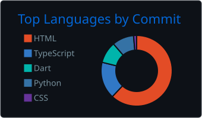
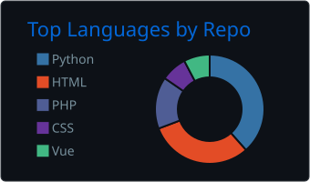
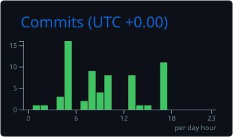

<div align="center">

# RACOONCODE

<a href="https://newsemaborneo.github.io/newsemaborneo/">
  
</a>


<br/>


<br/>

[](https://newsemaborneo.github.io/newsemaborneo/)

</div>

---

## ☠️ WHO AM I

```bash
$ whoami
> newsem_aborneo

$ cat profile.txt
> Role     : Full Stack Developer (Backend-focused)
> Stack    : NestJS, Laravel, Go, Python
> Playing  : IoT (ESP32), AI / Computer Vision (YOLO)
> Mission  : Bangun sistem yang cepat, aman, dan tahan banting
> Status   : Online ⚡
```

---

## ⚔️ ARSENAL

<div align="center">


<br/><br/>

<br/><br/>


</div>

---

## 🧪 CURRENTLY LEVELING UP

<table>
<tr>
<td width="50%">

```bash
$ ls ./learning
> go/              # backend performance
> flutter/         # mobile apps
> ai-integration/  # LLM & vision
> iot-esp32/       # MQTT, real-time
```

</td>
<td width="50%" align="center">


</td>
</tr>
</table>

---

## 📡 BATTLE STATS

<div align="center">







</div>

---

## 📬 CONTACT

<div align="center">

[](https://github.com/newsemaborneo)
<!--
Aktifkan dua baris di bawah setelah EMAIL_KAMU dan USERNAME_LINKEDIN kamu ganti, lalu hapus tanda komentar ini.
[](mailto:EMAIL_KAMU)
[](https://linkedin.com/in/USERNAME_LINKEDIN)
-->

<br/>


</div>
